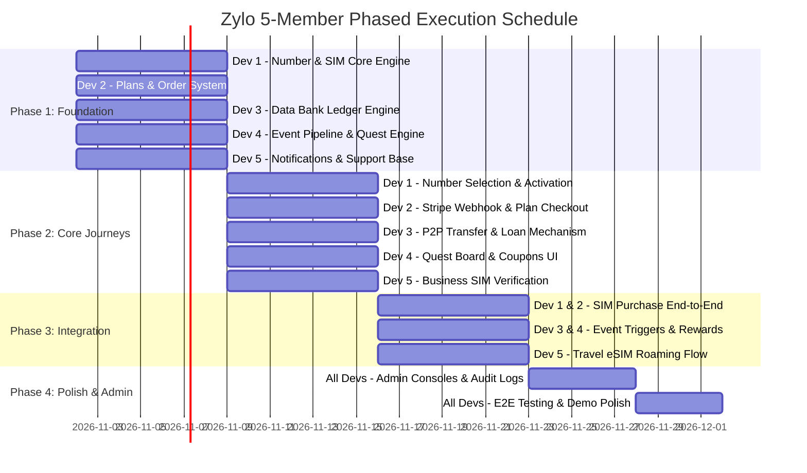

# Zylo Engineering Roadmap & 5-Member Team Module Allocation

> **Specification Reference:** [`ReactApp/AGENTS.md`](file:///c:/Users/Praveen/doodleblue4/ReactApp/AGENTS.md)  
> **Schema Reference:** [`Server/prisma/schema.prisma`](file:///c:/Users/Praveen/doodleblue4/Server/prisma/schema.prisma)  
> **Architecture Stack:** NestJS (Backend) • Prisma 7 + PostgreSQL • Redis (Locking & Caching) • Stripe • React 19 + Vite (Frontend) • TanStack Query & Table • Tailwind CSS • Radix UI

---

## 1. Executive Summary & Team Distribution

To build **Zylo** efficiently without merge conflicts, code churn, or blocking bottlenecks, the project is structured into **5 distinct vertical domains**. Each team member owns their domain **End-to-End** (Prisma queries, NestJS controllers/services/DTOs, API contracts, React UI components, and test suites).

| Member | Role / Domain | Core Prisma Entities | Primary Responsibilities |
| :--- | :--- | :--- | :--- |
| **Dev 1** | **Core Inventory & SIM Lifecycle Lead** | `PhoneNumber`, `Sim` | Phone number inventory (search, reserve, VIP types), SIM lifecycle (Personal/Business, Physical/eSIM, activation, grace period, suspension), Customer SIM dashboard shell, Admin inventory console. |
| **Dev 2** | **Plans, Commerce & Checkout Lead** | `Plan`, `PlanSubscription`, `Order`, `Payment`, `StripeSubscription` | Plan catalog & comparisons (Prepaid, Postpaid, Business), Order creation & checkout flow, Stripe webhook processing, payment idempotency, plan activation hooks, invoices & receipts. |
| **Dev 3** | **Core Innovations: Data Bank & P2P Transfer Lead** | `DataBankAccount`, `DataBankTransaction`, `DataTransfer`, `DataTransferRequest`, `DataLoan`, `DataLoanTransaction` | Data Bank daily rollover engine, lot expiry (FEFO redemption), P2P Data Transfer with atomic balance locks, Data Loan emergency borrowing, Customer Vault UI & Admin ledger audits. |
| **Dev 4** | **Engagement & Gamification Lead: Data Quest** | `Quest`, `UserQuest`, `RewardCoupon` | Behaviour-aware quest rules engine, domain event listener (`DATA_SAVED`, `DATA_TRANSFERRED`, `RECHARGE_SUCCEEDED`), XP/streak tracking, reward coupon generation, interactive Quest Board UI. |
| **Dev 5** | **Enterprise, Global eSIM & Support Operations Lead** | `BusinessOrganization`, `OrganizationMember`, `BusinessInvite`, `InternationalPlan`, `TravelEsimOrder`, `SupportTicket`, `Notification` | Business SIM onboarding & KYC verification, Travel eSIM international roaming catalog & QR code simulation, Customer support ticketing system, in-app notification center. |

---

## 2. Global Execution Timeline (Phased Roadmap)



---

## 3. Detailed Member Responsibilities & Deliverables

### 👤 Developer 1: Core Inventory & SIM Lifecycle Lead

#### Goal
Deliver rock-solid phone number discovery and SIM lifecycle states. Dev 1 provides the foundation: without active SIMs and assigned numbers, other features cannot execute.

#### Schema Entities
- `model PhoneNumber` (`id`, `number`, `prefix`, `type`, `price`, `status`, `reservedUntil`, `organizationId`)
- `model Sim` (`id`, `userId`, `phoneNumberId`, `category`, `technology`, `status`, `planExpiredAt`, `gracePeriodEndsAt`)
- Enums: `PhoneNumberStatus`, `PhoneNumberType`, `SimCategory`, `SimTechnology`, `SimStatus`

#### Backend Tasks (`Server/src/modules/`)
1. **`numbers` Module**:
   - `GET /api/v1/numbers`: Search available numbers with filters (`type=STANDARD|PREMIUM`, `prefix`, search pattern).
   - `POST /api/v1/numbers/reserve`: Temporarily lock a phone number for 15 minutes during checkout (using Redis TTL or `reservedUntil` timestamp).
   - `POST /api/v1/numbers/release`: Release expired reservations back to `AVAILABLE`.
2. **`sims` Module**:
   - `GET /api/v1/sims/my`: List all SIMs belonging to the authenticated user.
   - `GET /api/v1/sims/:id`: Retrieve single SIM status, technology (`PHYSICAL` vs `ESIM`), and active plan info.
   - `POST /api/v1/sims/activate`: Simulate carrier activation for a pending SIM.
   - Lifecycle transition service: State machine enforcing `PENDING_ACTIVATION` → `ACTIVE` → `GRACE_PERIOD` → `DEACTIVATED` / `SUSPENDED`.
3. **Admin Endpoints**:
   - `GET /api/v1/admin/numbers` & `POST /api/v1/admin/numbers/bulk`: Seed and manage inventory.
   - `PATCH /api/v1/admin/sims/:id/status`: Suspend/reactivate customer SIMs.

#### Frontend Tasks (`ReactApp/src/`)
1. **Components & Pages**:
   - Number Picker widget: Searchable list, filter by Standard / VIP patterns (e.g. repeating digits), reserve countdown timer.
   - Active SIM Header Selector: Global context/dropdown allowing customers with multiple SIMs to toggle their active view.
   - Customer SIM Settings card: View ICCID/eSIM QR code info, status badge, physical replacement request trigger.
   - Admin Inventory Management Console: TanStack table of all numbers and SIMs with filter by status.

---

### 👤 Developer 2: Plans, Commerce & Checkout Lead

#### Goal
Build the commercial engine: plan showcase, plan comparison, order creation, Stripe payment session orchestration, and atomic plan activation upon webhook confirmation.

#### Schema Entities
- `model Plan` (`id`, `name`, `type`, `price`, `validityDays`, `dataAllowanceGb`, `businessOnly`, `isActive`, `dataBankEnabled`)
- `model PlanSubscription` (`id`, `simId`, `planId`, `status`, `startDate`, `endDate`, `autoRenew`)
- `model Order` (`id`, `userId`, `type`, `status`, `amount`, `simId`, `phoneNumberId`, `planId`)
- `model Payment` (`id`, `orderId`, `stripePaymentIntentId`, `stripeCheckoutSessionId`, `status`, `paidAt`)
- Enums: `PlanType`, `PlanSubscriptionStatus`, `OrderType`, `OrderStatus`, `PaymentStatus`

#### Backend Tasks (`Server/src/modules/`)
1. **`plans` Module**:
   - `GET /api/v1/plans`: List public active plans with filtering (`PREPAID`, `POSTPAID`, `BUSINESS`, `VALIDITY_ONLY`).
   - `GET /api/v1/plans/:id`: Plan specifications, rollover limits, and daily caps.
   - Admin CRUD: `POST /api/v1/admin/plans`, `PATCH /api/v1/admin/plans/:id` (disable without breaking past subscriptions).
2. **`orders` Module**:
   - `POST /api/v1/orders/checkout`: Initiate checkout for SIM purchase, plan purchase, or recharge. Validates price server-side; applies valid coupon codes (from Dev 4).
   - Generates Stripe Checkout Session with metadata (`orderId`, `userId`, `simId`).
3. **`stripe` Webhook Enhancement**:
   - Secure, idempotent processing of `checkout.session.completed` and `payment_intent.succeeded`.
   - On payment success: Mark `Order` as `COMPLETED`, activate `PlanSubscription`, assign `PhoneNumber` permanently to `Sim`, trigger `RECHARGE_SUCCEEDED` domain event.
   - Dev-mode payment simulator toggle for local environments where Stripe CLI is not running.
4. **Billing & Receipts**:
   - `GET /api/v1/orders/history`: Customer transaction and recharge history with downloadable/viewable receipt data.

#### Frontend Tasks (`ReactApp/src/`)
1. **Components & Pages**:
   - Plans Explorer page (`/plans`): Tabbed layout (Popular, Unlimited 5G, Data Booster, Validity), comparison matrix.
   - Checkout Modal / Page: Order summary, coupon code input, payment method selector (Stripe Elements / redirect).
   - Payment Status Screen: Polling / webhook confirmation screen with celebratory success feedback.
   - Customer Recharge History: Detailed table of past recharges, invoice details, and expiry warnings.

---

### 👤 Developer 3: Core Innovations — Data Bank & P2P Transfer Lead

#### Goal
Implement Zylo’s primary product differentiators: the **Data Bank** piggy-bank ledger and **P2P Data Transfer**, plus the **Data Loan** feature.

#### Schema Entities
- `model DataBankAccount` (`id`, `simId`, `balanceMb`)
- `model DataBankTransaction` (`id`, `dataBankId`, `type`, `amountMb`, `balanceAfterMb`, `reference`, `expiresAt`)
- `model DataTransfer` (`id`, `reference`, `fromSimId`, `toSimId`, `amountMb`, `status`, `idempotencyKey`)
- `model DataTransferRequest` (`id`, `requesterSimId`, `recipientSimId`, `amountMb`, `status`)
- `model DataLoan` (`id`, `userId`, `simId`, `originalAmountMb`, `outstandingAmountMb`, `status`, `dueAt`)
- `model DataLoanTransaction` (`id`, `loanId`, `type`, `amountMb`, `balanceAfterMb`)
- Enums: `DataBankTransactionType`, `DataTransferStatus`, `DataLoanStatus`

#### Backend Tasks (`Server/src/modules/`)
1. **`data-bank` Module**:
   - Auto-create `DataBankAccount` upon SIM activation.
   - `GET /api/v1/data-bank/balance`: Current balance, active lots, and upcoming expirations.
   - `POST /api/v1/data-bank/save-daily`: Simulated end-of-day unused data rollover (with configurable daily cap e.g. 500 MB, max bank cap e.g. 10 GB).
   - `POST /api/v1/data-bank/redeem`: Atomic redemption using FEFO (First-Expiring, First-Out) lot logic. Enforces no negative balances.
   - Cron/worker task for lot expiry (`DataBankTransactionType.EXPIRY`).
2. **`data-transfer` Module**:
   - `POST /api/v1/data-transfer/send`: Atomic P2P transfer between two Zylo numbers. Requires Redis distributed lock or Prisma `$transaction` with balance validation. Idempotency key required.
   - `POST /api/v1/data-transfer/request`: Request data from another Zylo number; recipient can approve/decline.
   - Emits `DATA_SAVED`, `DATA_TRANSFERRED`, `DATA_RECEIVED` domain events.
3. **`data-loan` Module**:
   - `POST /api/v1/data-loan/borrow`: Emergency 500 MB / 1 GB loan when regular quota is exhausted.
   - Auto-repayment deductions on next recharge or rollover.

#### Frontend Tasks (`ReactApp/src/`)
1. **Components & Pages**:
   - Data Bank Interactive Hub (`/data-bank`): Modern animated vault/circle displaying balance in GB/MB, rollover calculator, lots timeline breakdown.
   - Quick Save & Redeem Sliders: Visual control to withdraw data into the active connection.
   - Data Transfer Portal (`/data-transfer`): Friend recipient lookup by phone number, real-time balance check, transfer confirmation dialog with receipt.
   - Data Loan Emergency Drawer: Emergency data top-up card with clear repayment schedule.

---

### 👤 Developer 4: Engagement & Gamification Lead: Data Quest

#### Goal
Implement Zylo’s behaviour-aware **Data Quest** engine: dynamic challenges, XP progression, badges, and tangible rewards (recharge discounts and bonus Data Bank MBs).

#### Schema Entities
- `model Quest` (`id`, `title`, `description`, `metric`, `frequency`, `targetValue`, `rewardType`, `rewardAmountMb`, `rewardDiscountPaise`, `isActive`)
- `model UserQuest` (`id`, `userId`, `questId`, `periodStart`, `periodEnd`, `progress`, `status`, `completedAt`, `claimedAt`)
- `model RewardCoupon` (`id`, `userId`, `userQuestId`, `code`, `discountPaise`, `minimumRechargePaise`, `expiresAt`, `redeemedAt`)
- Enums: `QuestMetric`, `QuestFrequency`, `QuestStatus`, `QuestRewardType`

#### Backend Tasks (`Server/src/modules/`)
1. **Domain Event Pipeline**:
   - Internal EventEmitter or Redis-backed dispatcher to ingest events from other services:
     - `DATA_SAVED`: Increments `DATA_BANK_SAVED_MB`.
     - `DATA_TRANSFERRED`: Increments `DATA_TRANSFERRED_MB`.
     - `RECHARGE_SUCCEEDED`: Increments recharge counters.
     - `DAILY_CHECK_IN`: Triggered on customer dashboard load.
2. **`quests` Rules Engine**:
   - Intelligent quest assignment: Suggests quests based on user behavior (e.g. if user never transferred data, suggest "First Transfer").
   - `GET /api/v1/quests/active`: Retrieve daily and weekly quests with live progress.
   - `POST /api/v1/quests/:id/claim`: Verify completion; atomically credit reward (generate unique `RewardCoupon` or execute deposit into `DataBankAccount`). Idempotent.
3. **Admin Management**:
   - `GET /api/v1/admin/quests`, `POST /api/v1/admin/quests`: Create custom challenges, set target thresholds, and define discount amounts.

#### Frontend Tasks (`ReactApp/src/`)
1. **Components & Pages**:
   - Data Quest Dashboard widget & dedicated page (`/quests`): Gamified card interface with animated progress bars, level/XP badges, and countdown timers.
   - Claim Reward Modal: Confetti and reveal animation when unlocking bonus MBs or coupons.
   - Rewards Wallet / Coupons Drawer: List of active discount vouchers with one-click copy and "Apply to Recharge" shortcut.
   - Admin Quest Builder: Form for admins to craft new quests and schedule weekly campaigns.

---

### 👤 Developer 5: Enterprise, Global eSIM & Support Operations Lead

#### Goal
Deliver the high-value expansion features: **Business SIM onboarding & verification**, **Travel eSIM international roaming catalog**, and the **Customer Support & Notifications** system.

#### Schema Entities
- `model BusinessOrganization`, `OrganizationMember`, `BusinessInvite`
- `model InternationalPlan`, `TravelEsimOrder`
- `model SupportTicket`, `Notification`, `StoredFile`
- Enums: `OrganizationStatus`, `OrganizationMemberRole`, `TravelEsimOrderStatus`, `SupportCategory`, `TicketStatus`, `TicketPriority`

#### Backend Tasks (`Server/src/modules/`)
1. **`business` Module**:
   - `POST /api/v1/business/register`: Submit organization details, requested 4-digit prefix, and upload GST/business proof (stored via `StorageModule`).
   - `POST /api/v1/business/invite`: Owner invites employees via email token (`BusinessInvite`).
   - Admin review: `PATCH /api/v1/admin/business/:id/verify` (approve with prefix assignment or reject with reason).
2. **`travel-esim` Module**:
   - `GET /api/v1/travel-esim/plans`: Search country plans (e.g. US, SG, AE, UK, JP).
   - `POST /api/v1/travel-esim/orders`: Order flow with encrypted passport data, dates, and mock QR code installation generator.
3. **`support` & `notifications` Modules**:
   - `POST /api/v1/support/tickets`: Customer creates support ticket with category and attachment.
   - `GET /api/v1/admin/support/tickets` & `PATCH /api/v1/admin/support/tickets/:id`: Admin reply, prioritize, and resolve.
   - In-app notification dispatcher (`GET /api/v1/notifications`, `PATCH /:id/read`) to alert users on SIM activation, transfer receipt, quest completion, and ticket replies.

#### Frontend Tasks (`ReactApp/src/`)
1. **Components & Pages**:
   - Business SIM Onboarding Portal: Multi-step registration form with document drag-and-drop and verification status tracker.
   - Travel Connect Hub (`/travel`): Country search, data roaming packages, travel date selector, and interactive eSIM installation guide with QR code modal.
   - Support Desk (`/support`): Ticket submission modal, conversation timeline, status chips.
   - Global Notification Bell: Top navbar popover displaying unread alerts with direct navigation links.
   - Admin Operations Console: Tabbed interface for Business KYC approvals and ticket resolutions.

---

## 4. Step-by-Step Execution Plan: What to Start First

### Sprint 1: Contracts, Stubs & Core Engine (Days 1 – 5)

> **Team Goal:** Establish shared types, compile all schemas, create service stubs, and stand up independent domain models.

| Member | Day 1 | Day 2 | Day 3 | Day 4 | Day 5 |
| :--- | :--- | :--- | :--- | :--- | :--- |
| **Dev 1** | Generate Prisma client, scaffold `numbers` & `sims` modules | Implement `GET /numbers` with search & standard/VIP filters | Implement `POST /numbers/reserve` (15m lock) | Build `Sim` status state machine & customer list endpoint | Build React Number Selector UI & VIP badges |
| **Dev 2** | Scaffold `plans` & `orders` NestJS modules | Implement `GET /plans` & plan details with filter tags | Implement `POST /orders/checkout` & validation | Wire Stripe Checkout Session creation | Build React `/plans` grid & comparison card |
| **Dev 3** | Scaffold `data-bank` & `data-transfer` modules | Create `DataBankAccount` listener & ledger model | Implement daily unused rollover calculation service | Implement FEFO lot redemption logic | Build React Data Bank vault visualizer component |
| **Dev 4** | Scaffold `quests` module & internal event types | Seed initial Quest definitions in database | Implement user quest progress query & period calculation | Build Event Dispatcher for `DATA_SAVED` / `TRANSFER` | Build React Quest Card & Progress Bar UI |
| **Dev 5** | Scaffold `support` & `notifications` modules | Implement `POST /support/tickets` & user ticket list | Build `NotificationService.send()` & user polling route | Scaffold `business` & `travel-esim` modules | Build Global Notification Bell & Support Modal in React |

---

### Sprint 2: Core Journeys & Inter-Module Wiring (Days 6 – 10)

> **Team Goal:** Connect checkout to SIM activation, wire transactions into event pipelines, and make the customer flows fully testable.

| Member | Focus Deliverables | Cross-Team Integration Point |
| :--- | :--- | :--- |
| **Dev 1** | Finalize SIM activation flow (`POST /sims/activate`); add Physical vs eSIM details; build Customer Dashboard connection overview card. | Consumes order status from **Dev 2** to unlock activation. |
| **Dev 2** | Complete Stripe Webhook listener; implement idempotent database transactions updating Order, PlanSubscription, and Sim. | Calls **Dev 1**’s SIM activation; fires `RECHARGE_SUCCEEDED` event for **Dev 4**. |
| **Dev 3** | Implement atomic `POST /data-transfer/send` with Redis lock / DB isolation; build friend lookup and transfer confirmation modal. | Emits `DATA_TRANSFERRED` event consumed by **Dev 4**; sends notification via **Dev 5**. |
| **Dev 4** | Complete `POST /quests/:id/claim`; generate unique `RewardCoupon` records; build active coupon wallet and claim animations. | Emits coupons consumed by **Dev 2** during checkout. |
| **Dev 5** | Build Business SIM registration with document upload; build Travel eSIM country catalog and passport checkout flow. | Uses **Dev 2**’s checkout for travel eSIM orders; uses **Dev 1**’s prefix logic. |

---

### Sprint 3: Innovation Refinement & Edge Cases (Days 11 – 15)

> **Team Goal:** Implement automated jobs, audit logging, error handling, and business logic constraints.

1. **Dev 1 (Inventory Edge Cases):** Handle reservation timeouts, number recycling rules, and SIM deactivation grace period alerts.
2. **Dev 2 (Billing Robustness):** Add recurring auto-renewal logic, failed payment recovery states, and PDF/HTML receipt generation.
3. **Dev 3 (Innovations Depth):** Implement `DataLoan` borrowing & repayment hooks; implement scheduled lot expiration worker.
4. **Dev 4 (Adaptive Quests):** Add behavior-aware logic (recommending quests dynamically based on customer activity metrics).
5. **Dev 5 (Admin Verification):** Build Admin KYC review portal for Business SIMs; complete Travel eSIM QR code rendering and offline setup guides.

---

### Sprint 4: Unified Admin, Polishing & Demo Readiness (Days 16 – 20)

> **Team Goal:** Full end-to-end integration, role-based admin consoles, design polishing, and load/smoke testing.

- **Admin Integration:** Connect Admin navigation tabs for all 5 domains inside `ReactApp/src/app/(mainapp)/console-shell.tsx`.
- **E2E Customer Journey Testing:** Signup → Pick Number → Choose Plan → Stripe Test Checkout → SIM Activated → Save Data to Bank → Transfer to Friend → Complete Quest & Claim Reward.
- **UI/UX Consistency:** Ensure consistent INR (₹) formatting, data units (MB/GB), skeleton loading states, empty states, and toast notifications.
- **Code Quality:** Zero ESLint / Oxlint errors, strict TypeScript types, and comprehensive Vitest unit/integration tests for sensitive mutations.

---

## 5. Architecture Contracts & Inter-Module API Map

```
┌────────────────────────────────────────────────────────────────────────┐
│                        ReactApp (Vite + React 19)                      │
│   ┌───────────────┬──────────────┬──────────────┬──────────────────┐   │
│   │ Number Picker │ Plans Matrix │  Data Vault  │   Quest Board    │   │
│   │   (Dev 1)     │   (Dev 2)    │   (Dev 3)    │     (Dev 4)      │   │
│   └───────┬───────┴──────┬───────┴──────┬───────┴──────────┬───────┘   │
└───────────┼──────────────┼──────────────┼──────────────────┼───────────┘
            │              │              │                  │
            ▼              ▼              ▼                  ▼
┌────────────────────────────────────────────────────────────────────────┐
│                         Server (NestJS Backend)                        │
│   ┌──────────────┐   ┌──────────────┐   ┌──────────────┐   ┌────────┐  │
│   │ Number / Sim │   │ Plans/Orders │   │ Data Bank &  │   │ Quests │  │
│   │   (Dev 1)    ├──►│   (Dev 2)    ├──►│ Transfer(D3) ├──►│  (D4)  │  │
│   └──────────────┘   └──────┬───────┘   └──────┬───────┘   └────────┘  │
│                             │                  │                       │
│                             ▼                  ▼                       │
│                      ┌─────────────────────────────────┐               │
│                      │      Domain Event Pipeline      │               │
│                      │ (DATA_SAVED, RECHARGE, etc.)    │               │
│                      └────────────────┬────────────────┘               │
│                                       │                                │
│                                       ▼                                │
│                      ┌─────────────────────────────────┐               │
│                      │ Notifications & Support (Dev 5) │               │
│                      └─────────────────────────────────┘               │
└───────────────────────────────────────┬────────────────────────────────┘
                                        ▼
                        PostgreSQL Database (Prisma 7)
```

### Critical Shared Interfaces
1. **Order Creation Contract (Dev 1 & Dev 2):**
   ```ts
   interface CreateOrderDto {
     type: 'SIM_PURCHASE' | 'PLAN_PURCHASE' | 'RECHARGE';
     planId?: string;
     phoneNumberId?: string; // Must be reserved by Dev 1's service
     couponCode?: string;    // Validated against Dev 4's RewardCoupon
   }
   ```
2. **Event Dispatch Contract (Dev 2, Dev 3 & Dev 4):**
   ```ts
   interface ZyloDomainEvent {
     eventType: 'DATA_SAVED' | 'DATA_TRANSFERRED' | 'RECHARGE_SUCCEEDED' | 'DAILY_CHECK_IN';
     userId: string;
     simId?: string;
     amountMb?: number;
     metadata?: Record<string, any>;
     timestamp: Date;
   }
   ```

---

## 6. Definition of Done (DoD) per Module

Before any developer considers a module complete:
1. **Database Consistency:** Uses Prisma transactions (`$transaction`) for any multi-record mutations (transfers, checkouts, lot expirations).
2. **Server-Side Validation:** All incoming payloads are validated with `class-validator` DTOs; never trusts balance or price sent by client.
3. **Idempotency:** Webhooks and balance mutations accept and enforce idempotency keys.
4. **Role Guarding:** All routes are protected by `@UseGuards(JwtAuthGuard, RolesGuard)` separating `CUSTOMER` and `SUPER_ADMIN`.
5. **UI Polish:** Includes skeleton loading states, empty states, error toasts, and confirmation dialogs for destructive/financial actions.
6. **Lint & Build:** `pnpm lint` and `pnpm build` pass with zero warnings in both `Server/` and `ReactApp/`.
